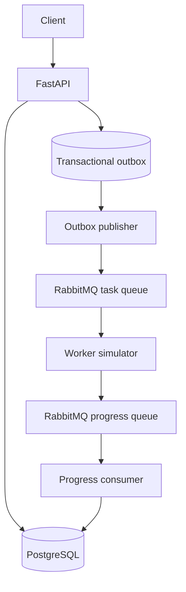

# Tenant Provisioning Control Plane

A Python implementation of the take-home assignment: an asynchronous, multi-tenant control plane with a REST API, PostgreSQL persistence, RabbitMQ messaging, an outbox publisher, a progress consumer, and a configurable worker simulator.

## Quick start

Requirements: Docker Engine and Docker Compose v2.

```bash
git clone https://github.com/RahulNama1995/tenant-provisioning-control-plane.git
cd tenant-provisioning-control-plane
docker compose up --build -d
```

The API is available at `http://localhost:8000`; interactive OpenAPI docs are at `/docs`. RabbitMQ management UI is at `http://localhost:15672` (`guest` / `guest`).

Run the full quality gate (formatting, lint, security scan, and test suite) with one command:

```bash
docker compose exec api make check
```

To auto-format after making changes:

```bash
docker compose exec api make format
```

Stop services:

```bash
docker compose down
```

To reset persisted data, use `docker compose down -v` (destructive).

## Architecture



- **API** validates requests and enforces tenant lifecycle guards.
- **PostgreSQL** stores tenants, tasks, outbox events, processed update IDs, and dead letters.
- **Outbox publisher** publishes only rows committed by API transactions. It uses publisher confirms and retries after connection or broker failures.
- **Worker** consumes durable task messages and emits `in_progress` followed by `done` or `failed`.
- **Progress consumer** applies updates transactionally, acknowledges successful/duplicate/stale messages, and isolates poison messages in `dead_letters`.

## Design decisions and trade-offs

### Transactional outbox

A tenant mutation, task row, and outbox row are committed in one database transaction. The publisher only reads committed outbox rows. It publishes with RabbitMQ publisher confirms, then marks the row as published. This avoids the dual-write bug where a task is committed but its event is never sent.

The outbox provides **at-least-once delivery**, not magical exactly-once delivery: if the broker confirms a publish and the process crashes before marking the outbox row, it can be published again. Consumers must therefore be idempotent. The task ID is the event ID.

### Concurrency / optimistic locking

Tenant mutations lock the tenant row with `SELECT ... FOR UPDATE`, compare the supplied version, then increment it in the same transaction. Competing PATCH requests with the same version serialize: one commits and the other observes a stale version and receives `tenant_version_conflict`. The unique database constraint on `tenants.slug` is the final authority for concurrent duplicate creates, including destroyed tenants.

### Inbound idempotency and ordering

Each worker progress message has a UUID `update_id`. `processed_updates` records it in the same transaction as the state mutation. A duplicate ID is a no-op. The task row is locked before applying an update; terminal tasks are immutable, so late `in_progress` or terminal updates cannot regress them. A terminal result may be applied even if `in_progress` was delayed or lost.

### Poison messages and retries

### Poison messages and retries

Malformed or permanently unprocessable progress messages are recorded in the PostgreSQL `dead_letters` table and acknowledged to prevent repeated delivery.

Transient database failures are retried using a durable RabbitMQ retry queue with exponential backoff (1s, 2s, and 4s). After the configured retry limit, messages are moved to `provisioning.progress.dlq` for inspection and manual recovery.

The consumer reconnects after broker failures. Retry messages are published before the original message is acknowledged to reduce the risk of message loss.

### Scope

This is intentionally a single deployable API unit plus a separate worker process. Schema creation uses SQLAlchemy `create_all` for a frictionless local exercise; production evolution should use Alembic migrations. Authentication, authorization, rate limiting, and tenant isolation policies are outside the supplied assignment contract.

## API contract

All error bodies use:

```json
{"error":{"code":"tenant_not_found","message":"Tenant not found"}}
```

| Method | Path | Description |
|---|---|---|
| `POST` | `/tenants` | Create tenant and accepted deploy task |
| `GET` | `/tenants` | List tenants (`limit`, `offset`) |
| `GET` | `/tenants/{tenant_id}` | Get tenant |
| `PATCH` | `/tenants/{tenant_id}` | Start update from `active`; request must include current `version` |
| `DELETE` | `/tenants/{tenant_id}` | Start destroy from `active` or `failed` |
| `GET` | `/tasks` | List tasks; optional `tenant_id`, `limit`, `offset` |
| `GET` | `/tasks/{task_id}` | Get task |
| `GET` | `/health` | Health check |

Error codes: `tenant_not_found` (404), `task_not_found` (404), `tenant_already_exists` (409), `tenant_update_not_allowed` (409), `tenant_version_conflict` (409). Validation errors use FastAPI's standard structured 422 response.

Timestamps are serialized in UTC with millisecond precision and a `Z` suffix.

### Examples

Create:

```bash
curl -i -X POST http://localhost:8000/tenants \
  -H 'Content-Type: application/json' \
  -d '{"slug":"acme-prod","name":"Acme Production"}'
```

List tenants and tasks:

```bash
curl http://localhost:8000/tenants
curl http://localhost:8000/tasks
```

Fetch one tenant/task using IDs from the responses:

```bash
curl http://localhost:8000/tenants/<tenant-id>
curl http://localhost:8000/tasks/<task-id>
```

Update requires the latest version returned by the tenant endpoint:

```bash
curl -X PATCH http://localhost:8000/tenants/<tenant-id> \
  -H 'Content-Type: application/json' \
  -d '{"name":"Acme Production v2","version":2}'
```

Delete starts asynchronous destruction:

```bash
curl -X DELETE http://localhost:8000/tenants/<tenant-id>
```

## Worker scenarios

The default worker succeeds after a randomized 300–1200 ms delay. Restart it with a 100% failure rate:

```bash
docker compose stop worker
docker compose run --rm worker python -m worker.simulator --fail-rate 1 --min-delay-ms 100 --max-delay-ms 200
```

For normal behavior again:

```bash
docker compose stop worker
docker compose up -d worker
```

To change the default worker settings, set `WORKER_FAIL_RATE`, `WORKER_MIN_DELAY_MS`, and `WORKER_MAX_DELAY_MS` in your shell or `.env` before `docker compose up`.

### Publishing a duplicate or stale progress update

The worker progress queue accepts JSON messages of this shape:

```json
{
  "update_id": "a UUID used as the idempotency key",
  "task_id": "the task UUID",
  "status": "in_progress | done | failed",
  "error": null
}
```

Use RabbitMQ's management UI (`http://localhost:15672`, guest/guest), select `provisioning.progress`, and publish the same JSON twice with the same `update_id` to demonstrate duplicate delivery. To demonstrate order tolerance, publish a `done` event and then an `in_progress` event for the same task (use distinct update IDs); the task remains terminal. For a reproducible manual test, use a real task UUID from `GET /tasks`.

## Testing

The project includes automated tests covering tenant lifecycle management, concurrency, event processing, and failure recovery.

### Test scenarios

- Tenant creation, deployment, update, and destruction lifecycle.
- Duplicate tenant slug prevention, including previously destroyed tenants.
- Tenant state validation and invalid operations.
- Optimistic locking and concurrent tenant updates.
- Task state transitions and terminal-state immutability.
- Duplicate progress event handling through idempotency.
- Out-of-order progress event handling.
- Concurrent worker progress delivery.
- Worker failure handling and tenant recovery.
- Transactional outbox behavior during broker outages.
- Worker reconnection after RabbitMQ failures.
- Poison message handling and dead-letter queues.
- Bounded retries with exponential backoff.
- Database outage and recovery.

### Run automated tests

```bash
pytest -v
```

### Run code quality checks

```bash
ruff check .
ruff format --check .
bandit -r app worker -ll
```

### Run application smoke test

```bash
bash scripts/smoke_test.sh
```

## Repository hygiene

No secrets are required. `.env` is ignored; `.env.example` contains only non-secret local defaults. Before submitting, create a public GitHub repository, review `git diff`, and push the project.
